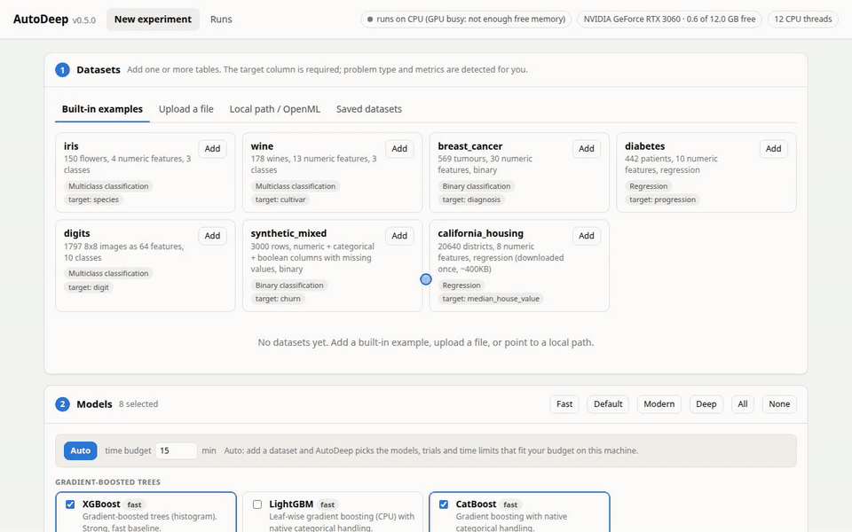
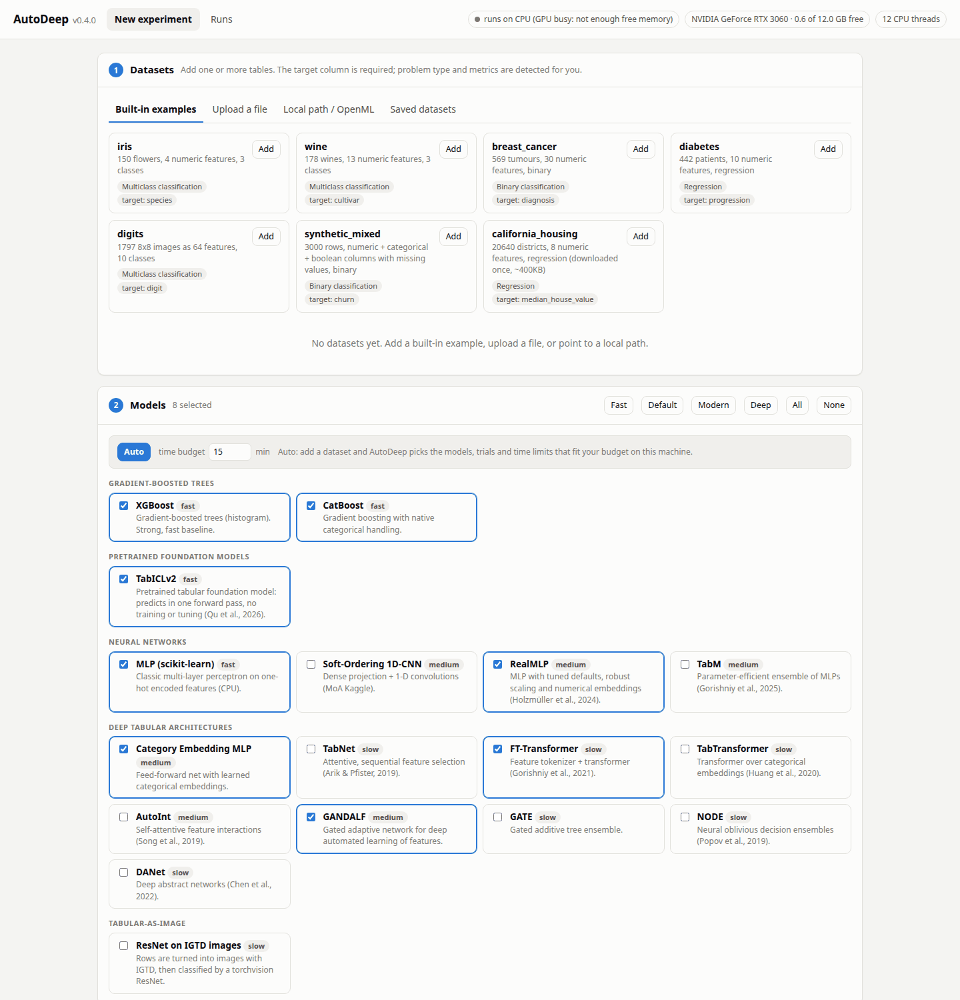
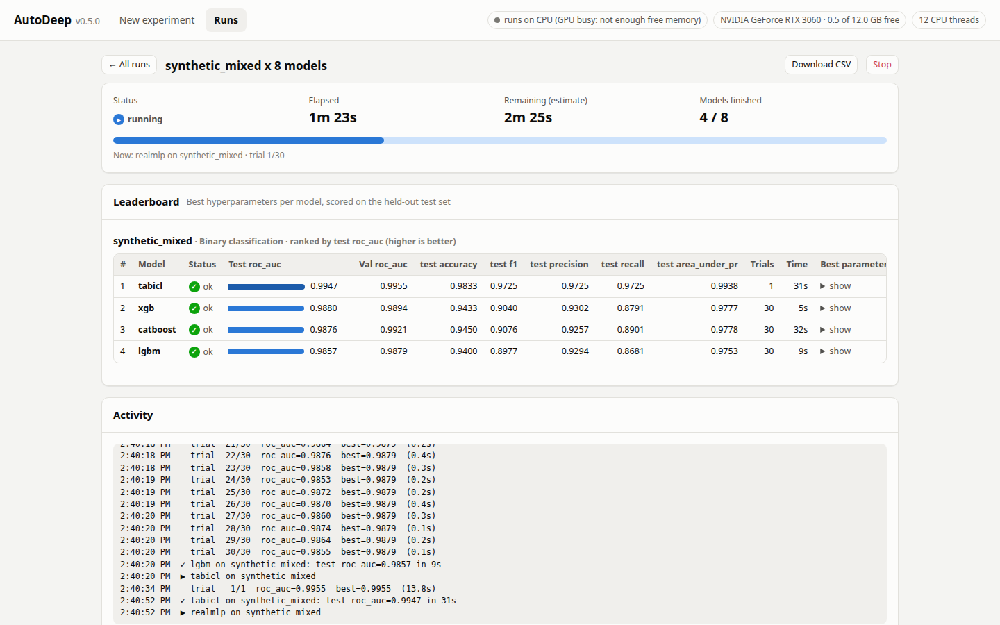
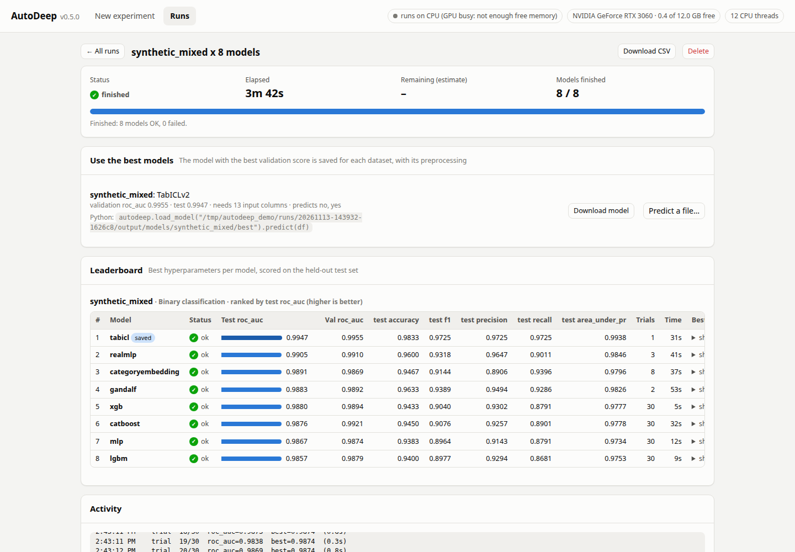

# AutoDeep

[](https://github.com/mdicio/AutoDeep/actions/workflows/ci.yml)


**Benchmark gradient-boosted trees and deep learning models on your tabular data, with hyperparameter search, runtime estimates and a local web app.**

<p align="center">
  <br>
  <sub>The web app on a 6-core desktop CPU: one dataset, a 3-minute budget, 8 models picked automatically (the run is sped up 15x). <a href="images/demo.mp4">Full-resolution video</a>.</sub>
</p>

## Description

AutoDeep is a flexible and easy-to-use API for automating machine learning experiments (AutoML) on tabular datasets. It facilitates testing various deep learning models as well as tree based models to compare their performance on multiple datasets with hyperparameter optimization and evaluation. By using the AutoRunner class (or the command line, or the web app), you can quickly train and evaluate models like XGBoost, LightGBM, CatBoost, the TabICLv2 foundation model, RealMLP, TabM, FT-Transformer, ResNet, and more on tabular data.

The goal of this project is to provide an easy interface for training, hyperparameter tuning, and evaluating models, so researchers and developers can quickly benchmark different models on their datasets. By default it picks the models that fit your time budget on your machine, and it saves the best model of each dataset, ready to predict new rows.

```bash
autodeep run data/churn.csv --target churned --budget 10m      # plan, train, compare, save the best model
autodeep predict output/models/churn/best new_customers.csv -o predictions.csv
```

## Features

- **Supports multiple machine learning models**: 19 models, from gradient-boosted trees (XGBoost, LightGBM, CatBoost) to the TabICLv2 foundation model, RealMLP, TabM, nine deep tabular architectures (FT-Transformer, TabNet, GANDALF, …), a 1D-CNN and a ResNet on IGTD images.
- **Hyperparameter optimization**: Automatically tunes hyperparameters using Bayesian Optimization (Hyperopt TPE), with a search space per model and per dataset size.
- **Fits your time budget**: `models: auto` measures your machine and picks the models, trials and time limits that fit, and tells you what it skipped and why. Runtime estimates before anything is trained, live ETA while it runs.
- **Data configuration**: Only a path and a target column are needed. Problem type, metric, column types and preprocessing are inferred; CSV, Parquet, Excel, JSON, built-in datasets and OpenML work out of the box.
- **Web app, CLI and Python API**: the same experiments from a browser, a terminal or a notebook.
- **Ready-to-use models**: the best model of each dataset is saved with its preprocessing. Load it and call `predict` on new rows, or use `autodeep predict`.
- **Output handling**: Saves the results of experiments, including evaluation metrics, every trial and the best hyperparameters, in CSV format.
- **Easy integration**: Simple to configure and extend with additional models or datasets.

---

## Installation

You need Python 3.10 – 3.13. A GPU is optional.

1. Clone the repository:

```bash
git clone https://github.com/mdicio/AutoDeep.git
cd AutoDeep
```

2. Install the dependencies. **With [uv](https://docs.astral.sh/uv/)** (recommended, uses the exact tested versions from `uv.lock`):

```bash
uv sync
uv run autodeep quickstart        # 30-second smoke test on built-in datasets
```

**With pip:**

```bash
python -m venv .venv && source .venv/bin/activate     # Windows: .venv\Scripts\activate
pip install -e .                                       # or: pip install -r requirements.txt
autodeep quickstart
```

Optional extras: `pip install -e ".[files]"` adds Parquet/Feather/Excel input, `".[dev]"` adds the test tools.

> With uv, prefix the commands below with `uv run` (e.g. `uv run autodeep ui`), or activate `.venv` first.

---

## Quick start in Python

```python
from autodeep import AutoRunner

runner = AutoRunner(
    datasets={"churn": {"path": "data/churn.csv", "target": "churned"}},
    time_budget="10m",                   # AutoDeep picks the models that fit 10 minutes on this machine
)
leaderboard = runner.run()               # pandas DataFrame, best test score first

model = runner.best_model("churn")       # saved with its preprocessing in output/models/churn/best
model.predict(new_customers)             # original labels, one per row
```

That is all you need. The sections below show the three ways to use AutoDeep in more detail.

---

## How to Use

### 1. Web app

```bash
autodeep ui
```

This opens `http://127.0.0.1:8765` (or the next free port). Then:

1. **Datasets.** Add a built-in example, upload a CSV/TSV/Parquet/Excel/JSON file, or point to a local path or `openml:<name>`. The target, problem type and metric are detected; you can change them, set a split column, subsample, and untick columns to exclude (IDs and free text are flagged for you).
2. **Models.** **Auto** (the default) picks the models, trials and time limits that fit your time budget on this machine and tells you why it skipped the others. Or pick models one by one, or use a preset (Fast, Default, Modern, Deep, All).
3. **Settings and estimate.** Set trials per model, a time limit per model, a max-epochs cap and the device (Auto fills these in). The estimated runtime updates as you change things.
4. **Run.** Each experiment runs in its own background process. You get a live progress bar with an ETA, an activity feed, the log, and a leaderboard that fills in as models finish. You can stop a run at any time, close the browser and come back later, and download the results as CSV.
5. **Use the model.** The best model of each dataset is saved. Download it, or upload a file and get its predictions back as CSV.

Uploaded files and runs are stored in `./autodeep_workspace` (change it with `--workspace`). Everything stays on your machine.

| Set up an experiment | Watch it run |
|---|---|
|  |  |



### 2. Command line

```bash
autodeep models                                  # what can I train?
autodeep datasets                                # built-in datasets
autodeep profile data/churn.csv --target churned # column types, missing values, inferred problem type
autodeep system                                  # cores, RAM, GPU and CPU speed as AutoDeep sees them
autodeep estimate data/churn.csv --target churned --budget 20m   # the automatic plan and how long it takes
autodeep run data/churn.csv --target churned --budget 20m        # shows the plan, asks to confirm, runs with live progress
autodeep run examples/experiment.yaml            # several datasets and options in a YAML file
autodeep run examples/experiment.yaml --models fast --max-evals 5 --max-epochs 20 -y
autodeep predict output/models/churn/best new.csv -o predictions.csv    # use the saved best model
autodeep info output/models/churn/best          # its input columns, scores and parameters
```

An experiment file looks like this (full commented version: [`examples/experiment.yaml`](examples/experiment.yaml)):

```yaml
datasets:
  iris:
    path: builtin:iris
  churn:
    path: data/churn.csv
    target: churned
    drop_columns: [customer_id]
models: auto                             # default; or [xgb, catboost, fttransformer], or a preset
time_budget: 20m                         # whole run
output_folder: results
```

### 3. Python

#### Prepare the data configuration

Define the datasets you want to run experiments on in the `datasets` dictionary. Each dataset needs a `path` and a `target` column; everything else (problem type, metric, test size, split column, evaluation metrics, …) is optional and listed in [Defining datasets](#defining-datasets).

#### Define the models to use

`models="auto"` (the default) chooses for you within `time_budget`. You can also give a list such as `["xgb", "catboost", "mlp"]`, or a preset (`"fast"`, `"default"`, `"modern"`, `"deep"`, `"all"`). The supported models are listed in [Models](#models).

#### Initialize AutoRunner and run the experiment

```python
from autodeep import AutoRunner

runner = AutoRunner(
    datasets={
        "iris": {"path": "builtin:iris"},
        "churn": {"path": "data/churn.csv", "target": "churned", "drop_columns": ["customer_id"]},
    },
    time_budget="20m",          # models="auto": what fits 20 minutes on this machine
    # models=["xgb", "catboost", "fttransformer"], max_evals=20,   # ...or choose yourself
    output_folder="results",    # where you want experiment outputs and logs to be saved
    random_state=42,
)
print(runner.plan().describe()) # chosen models, trials, time limits and why
print(runner.estimate())        # runtime estimate per (dataset, model)
leaderboard = runner.run()      # pandas DataFrame, best test score first

model = runner.best_model("churn")       # saved in results/models/churn/best
model.predict(new_customers)             # original labels
model.predict_proba(new_customers)       # one column per class
```

This will start the training and evaluation of models on the specified datasets. The results will be saved in the output folder.

#### View results

After the experiment finishes, the results are saved in a CSV format in the `output_folder`, including performance metrics (train, validation, test) and hyperparameters. `ResultsAnalyzer` reads them back, also later from another session:

```python
from autodeep import ResultsAnalyzer

analyzer = ResultsAnalyzer(runner.results_path)
analyzer.view_results(dataset_name="churn", model_name="xgb")   # key columns, metrics and hyperparameters
analyzer.view_performance(dataset_name="churn")                  # performance columns only
analyzer.view_parameters(model_name="xgb")                       # hyperparameter columns only
```

All three filter by `dataset_name` and `model_name`.

See [`examples/quickstart.py`](examples/quickstart.py) and the notebook [`examples/walkthrough.ipynb`](examples/walkthrough.ipynb). The original constructor arguments (`data_config=`, `default_models=`, `dataset_path`/`target_col` keys) still work.

---

## Using the trained model

After a run, the best model of each dataset (highest validation score; the test set is never used to choose) is saved with everything needed to use it: the preprocessing fitted on the training data, the model and the original class labels.

```python
import autodeep

model = autodeep.load_model("results/models/churn/best")   # device="cpu" | "cuda" | "auto"
model.predict(df)              # labels / values, one per row
model.predict_proba(df)        # DataFrame, one column per class
model.predict_frame(df)        # prediction + proba_<class> columns, aligned with df
model.evaluate(labelled_df)    # metrics on rows that include the target column
model.info                     # dataset, model, scores, parameters, input columns
```

`df` needs the columns the model was trained on (extra columns, including the target, are ignored). Missing values, categories never seen in training and numbers stored as text are handled the same way as during training. From the command line: `autodeep predict <model folder> new.csv -o predictions.csv`. In the web app: the "Use the best models" card of a run.

`save_models=True` saves every model, not only the best one (`results/models/<dataset>/<model>`); `save_best=False` turns saving off. A saved model is a folder with `predictor.pt` and a readable `info.json`. It is a pickle, so only load models from sources you trust. Models trained on a GPU load on machines without one. TabICL keeps its training rows as context (that is how it predicts), so its saved file contains them; its pretrained weights are re-downloaded from Hugging Face if they are not cached.

---

## Defining datasets

Only `path` and `target` are required; everything else is inferred or has a default.

| Option | Default | Meaning |
|---|---|---|
| `path` | – | A file (`.csv .tsv .txt .parquet .feather .json .jsonl .xlsx`), `builtin:<name>` or `openml:<name or id>` |
| `target` | – | Target column (not needed for `builtin:`) |
| `problem_type` | inferred | `binary_classification`, `multiclass_classification` or `regression` |
| `metric` | `roc_auc` / `accuracy` / `rmse` | Metric optimised by the search |
| `eval_metrics` | sensible set | Extra metrics reported for train, validation and test |
| `test_size` | `0.2` | Held-out fraction (stratified for classification) |
| `split_col`, `train_value`, `test_value` | – | Use your own train/test split column instead (it is excluded from the features) |
| `drop_columns` | `[]` | Columns to ignore |
| `max_rows` | all | Random subsample, handy for a first look |
| `sep` | auto-detected | CSV separator |

**Metrics:** `accuracy`, `balanced_accuracy`, `f1`, `precision`, `recall`, `roc_auc` (one-vs-rest for multiclass), `area_under_pr`, `log_loss`, `lift1/5/10/20`, `rmse`, `mse`, `mae`, `r2_score`. Aliases such as `f1_score`, `auc` or `r2` are accepted.

**Preprocessing (automatic):**
- Missing values are imputed using statistics from the training split only (median or mode).
- Classification targets are label-encoded. The original labels are kept.
- Column names are sanitised.
- Categorical columns are passed natively to CatBoost and the embedding-based deep tabular models, and one-hot encoded for XGBoost, the MLP and the CNNs. Rare levels are grouped beyond the 30 most frequent.
- Numeric features are standardised.

**Built-in datasets:** `iris`, `wine`, `breast_cancer`, `diabetes`, `digits`, `synthetic_mixed` (numeric, categorical and boolean columns with missing values) and `california_housing` (downloaded once).

---

## Models

| Name | Model | Family |
|---|---|---|
| `xgb` | XGBoost | gradient-boosted trees |
| `lgbm` | LightGBM | gradient-boosted trees |
| `catboost` | CatBoost | gradient-boosted trees |
| `tabicl` | [TabICLv2](https://github.com/soda-inria/tabicl), a pretrained in-context learner: no training, no tuning | foundation model |
| `realmlp` | [RealMLP](https://github.com/dholzmueller/pytabkit) (tuned-default MLP with numerical embeddings) | neural network |
| `tabm` | [TabM](https://github.com/yandex-research/tabm) (parameter-efficient MLP ensemble) | neural network |
| `resmlp` | Residual MLP (PyTorch); can start from another model's prediction via an offset column | neural network |
| `mlp` | scikit-learn MLP | neural network |
| `s1dcnn` | Soft-Ordering 1D-CNN | neural network |
| `categoryembedding` | Category-embedding MLP | deep tabular |
| `fttransformer` | FT-Transformer | deep tabular |
| `tabtransformer` | TabTransformer | deep tabular |
| `tabnet` | TabNet | deep tabular |
| `autoint` | AutoInt | deep tabular |
| `gandalf` | GANDALF | deep tabular |
| `gate` | GATE | deep tabular |
| `node` | NODE | deep tabular |
| `danet` | DANet | deep tabular |
| `resnet` | ResNet-18/34/50 on [IGTD](https://doi.org/10.1038/s41598-021-90923-y) images | tabular-as-image |

**Auto (default):** AutoDeep picks models in order of expected value for the device (on CPU: xgb, catboost, lgbm, tabicl, realmlp, gandalf, categoryembedding, tabm, fttransformer, mlp; on a GPU the deep models move up) and keeps each one whose minimum search (1 TabICL pass, 10 trials for boosted trees, 3 for neural networks) fits in its share of `time_budget` (default 15 minutes), with no model taking more than half of it. Every model then gets up to 30 trials and the same time limit, chosen so fast models finish all their trials and slow ones use the remaining time. `autodeep estimate` (or `runner.plan()`) shows the plan and why each skipped model was skipped. Explicit `max_evals` / `timeout_per_model` override the plan.

**Presets:** `fast` = xgb, lgbm, catboost, mlp · `default` = fast + tabicl, realmlp, categoryembedding, fttransformer, gandalf · `modern` = tabicl, realmlp, tabm · `deep` = realmlp, tabm and the nine deep tabular models · `all`.

**Which deep models to try first?** On the [TabArena](https://huggingface.co/spaces/TabArena/leaderboard) benchmark, TabICLv2, RealMLP and TabM are among the strongest tabular models, ahead of the older deep tabular architectures (which TabArena does not include). In AutoDeep's own [benchmark](benchmarks/README.md) on three datasets of 20,000-50,000 rows, TabICLv2 was the best model on two of them without any tuning, and tuned CatBoost/XGBoost won on the third (adult, mostly categorical).

The nine deep tabular architectures were ported from [PyTorch Tabular](https://github.com/manujosephv/pytorch_tabular) (MIT) to plain PyTorch modules in `autodeep/modelsdefinition/tabular_nets/`, and are trained by AutoDeep's own loop (early stopping, best weights kept in memory). Hyperparameter names are the same as in PyTorch Tabular's model configs. AutoDeep no longer depends on PyTorch Tabular, which pins `pandas<3`.

- **TabICLv2** makes predictions in one forward pass with the training rows as context, so a search always runs a single trial whatever `max_evals` is. Its weights (~110 MB, one checkpoint for classification and one for regression) are downloaded from Hugging Face on first use. It is quick on a GPU but slow on CPU, because prediction cost grows with rows × context. Validation scores come from the usual 80% split, and test predictions then use every training row as context. Its train metrics are not reported, because they would score the context rows against themselves. Training sets above 50,000 rows are subsampled to that size for the context (`max_context_rows`). The estimate warns when TabICL, TabM or the CNNs would take more than 5 minutes on CPU.
- **RealMLP** and **TabM** come from [pytabkit](https://github.com/dholzmueller/pytabkit). The first trial always uses the published tuned defaults (RealMLP-TD, TabM-D), and later trials search around them. In a `param_grid`, `null` means "the library's default".
- All three handle categorical columns and feature scaling themselves.

Recent foundation models with non-commercial or gated weights (TabPFN v2.5+, LimiX and others) are deliberately not included.

Search spaces live in [`autodeep/configuration/model_config.yml`](autodeep/configuration/model_config.yml). Datasets with 5,000 training rows or fewer use [`model_config_XS.yml`](autodeep/configuration/model_config_XS.yml), which has smaller batches and more patience. To use your own file for every dataset, pass `model_config="my_config.yml"` (or `model_config:` in the YAML). In a `param_grid`:

- a list of numbers means a range;
- a list of strings, booleans or lists means a choice;
- a single value means a constant.

---

## Runtime estimates

Before anything is trained, AutoDeep estimates how long each (dataset, model) search will take:

1. **Built-in cost curves** per model, measured on a 12-thread CPU. They scale with rows, features, epochs and the device. On a new machine they are scaled by a ~0.5 s CPU benchmark (cached for 30 days in `~/.cache/autodeep/machine.json`; `autodeep system --benchmark` re-runs it).
2. **Your machine's history.** Every finished trial is recorded in `~/.cache/autodeep/timings.jsonl`, and later estimates are rescaled to how fast your hardware actually was. The estimate table shows `history (n trials)` when this applies.
3. **A live ETA** during the run, recomputed after every trial from the observed trial times.

Neural models use early stopping, so their time varies the most. Estimates therefore come with a low–high range. Use `timeout_per_model` to put a hard budget on each search (the running trial always finishes) and `max_epochs` to cap training length.

---

## Outputs

Everything is written to `output_folder` (default `./output`):

| File | Content |
|---|---|
| `experiments.csv` | One row per (dataset, model): status, validation and test score, all metrics (JSON), best hyperparameters, duration, error if any |
| `trials/<dataset>__<model>.csv` | Every hyperparameter trial with its train/validation metrics and duration |
| `autodeep.log` | Full log |
| `models/<dataset>/best/` | The best model of each dataset, ready for `autodeep.load_model` / `autodeep predict` |
| `models/<dataset>/<model>/` | Every model, if `save_models=True` |

A model that fails is recorded with its error, and the run continues with the next one. Use `fail_fast=True` to stop at the first failure instead.

---

## GPU

`device="auto"` (the default) uses the GPU only if it has at least 2 GB free (change this with `AUTODEEP_MIN_FREE_GPU_MB`). Otherwise it trains on CPU. CPU training also works when another program has filled the GPU: recent PyTorch versions create a CUDA context inside `optimizer.step()` even for CPU parameters and crash with "out of memory", and AutoDeep disables that check for CPU-only optimizers. CatBoost always runs on CPU unless you pass `device="cuda"`, because a CatBoost GPU out-of-memory error kills the whole process. To force a device, use `device="cpu"` or `device="cuda"`, `--device`, or `AUTODEEP_DEVICE`.

---

## Troubleshooting

| Problem | Fix |
|---|---|
| `autodeep: command not found` | Activate the venv, or use `uv run autodeep …` |
| Port already in use | `autodeep ui` picks the next free port automatically; `--port` forces one |
| Very slow deep models on CPU | Set `max_epochs` (e.g. 30), fewer `max_evals`, or `max_rows` on the dataset |
| TabICL fails to download its weights | It needs internet access once (Hugging Face Hub). Afterwards the weights are cached in `~/.cache/huggingface` |
| Parquet / Excel files fail to load | `pip install -e ".[files]"` |

---

## Development

```bash
uv sync --extra dev
uv run pytest              # fast suite (~1 min); CI runs it on Python 3.10 and 3.12
uv run pytest -m slow      # trains every model on each problem type (a few minutes on CPU)
```

## Repository Structure

The repository is organized as follows:

- `autodeep/` – Core library: `automl.py` (AutoRunner), `datasets.py` (dataset specs and inference), `preprocessing.py` (fitted, replayable preprocessing), `predictor.py` (saved models), `autoplan.py` + `machine.py` (automatic plan and machine profile), `estimation.py`, `registry.py`, `cli.py`, `jobs.py`.
- `autodeep/modelsdefinition/` – One trainer per model on a shared hyperopt search loop (`autodeep/modelutils/search.py`); the deep tabular networks are in `tabular_nets/`.
- `autodeep/dataloaders/` – Data loading and IGTD images.
- `autodeep/configuration/` – Search spaces and default settings per model (`model_config.yml`, `model_config_XS.yml`).
- `autodeep/web/` – FastAPI server and single-page web app.
- `examples/` – A quickstart script, a walkthrough notebook and a commented experiment file.
- `benchmarks/` – Benchmark scripts and results.
- `tests/` – Test suite.

See [CHANGELOG.md](CHANGELOG.md) for what changed in each release.

## License

This project is licensed under the MIT License. See the [LICENCE](LICENCE) file for details.

## Acknowledgments

This library builds on top of several popular open-source projects, including [TabICL](https://github.com/soda-inria/tabicl), [pytabkit](https://github.com/dholzmueller/pytabkit), [Hyperopt](https://github.com/hyperopt/hyperopt), [XGBoost](https://xgboost.ai), [LightGBM](https://lightgbm.readthedocs.io), [CatBoost](https://catboost.ai), [PyTorch](https://pytorch.org) (obviously) and the [IGTD](https://github.com/zhuyitan/IGTD) algorithm.

Special thanks to [PyTorch Tabular](https://github.com/manujosephv/pytorch_tabular) (Manu Joseph, MIT licence), which provided a very intuitive API for deep learning models on tabular data: the deep tabular architectures in AutoDeep are adapted from it, and TabNet uses [pytorch-tabnet](https://github.com/dreamquark-ai/tabnet)'s network. If the owner ever sees this I would be honoured to try and integrate some of the AutoDeep functionalities in the project.
